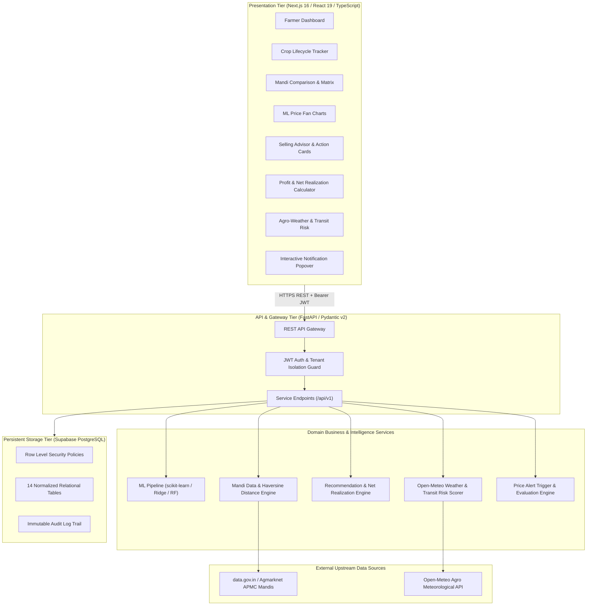

# System Architecture: Farmer Price Prediction & Market Recommendation System

## 1. High-Level Architecture Overview

The system is built on a modular, decoupled architecture adhering to strict separation of concerns across the presentation layer, API gateway, domain business logic, machine-learning intelligence, and persistent storage.

---

## 2. Core Intelligent Subsystems

### A. Machine Learning Forecasting Pipeline
* **Temporal Integrity**: Chronological train/test split ensuring zero lookahead bias or data leakage.
* **Feature Engineering**: Past price lags ($t-1, t-3, t-7, t-14, t-30$), rolling moving averages (7d, 14d, 30d), rolling standard deviations, day-of-week, and day-of-year seasonality.
* **Multi-Horizon Projections**: Simultaneous forecasting across 1, 3, 7, 15, and 30-day time horizons with 90% confidence uncertainty intervals.
* **Metric Reporting**: Evaluated on Mean Absolute Error (MAE), Root Mean Squared Error (RMSE), and Mean Absolute Percentage Error (MAPE).

### B. Net Selling Realization Engine
The system optimizes not simply for gross price, but for the actual money remaining in the farmer's pocket:
$$\text{Net Realization} = \text{Gross Revenue} - (\text{Transport Freight} + \text{Handling/Labor} + \text{APMC Cess} + \text{Storage/Spoilage Loss})$$
* **Geodesic Freight**: Geodesic Haversine distance from farm GPS to mandi gate multiplied by produce volume and vehicle freight rates.
* **Explainable Advisory**: Decision trees evaluate forecasted price appreciation against daily holding expenses (storage + spoilage) to recommend `SELL NOW`, `WAIT TO SELL`, or `PARTIAL SELL`.

### C. Agro-Meteorological & Transit Risk Scorer
* **Real-Time Weather Ingestion**: Connects to Open-Meteo for hyper-local surface temperature, relative humidity, wind speed, precipitation, and WMO codes.
* **Transit Hazard Assessment**:
  * Evaluates transit road moisture against perishability thresholds (e.g. wet onions decay rapidly during enclosed haulage).
  * Automatically issues tarpaulin coverage directives and safe dispatch departure windows.

---

## 3. Security & Multi-Tenant Protection

1. **Authentication**: Supabase Auth handles email/password and demo session creation with JWT tokens.
2. **Server-Side Authorization**: The FastAPI backend validates JWT claims using cryptographic verification. Farmer identity is resolved strictly from the verified token `sub` claim—never from untrusted client parameters.
3. **Supabase Row Level Security (RLS)**: All 14 PostgreSQL tables have RLS enabled with isolation policies ensuring farmers cannot access or mutate cross-tenant farm parcels, crops, or notifications.
4. **Opaque Identifiers**:
   * Farmers are assigned non-sequential opaque IDs: `AGRI-XXXX-XXXX`.
   * Crops are assigned non-sequential opaque IDs: `CROP-XXXX-XXXX`.

---

## 4. Data Freshness & Non-Fabrication Guarantee

* **No Hallucinated Market Prices**: If government mandi data is unavailable for a requested commodity or region, the system strictly returns `"Current reliable market data is unavailable."` without fabricating artificial prices.
* **Statistical Limitation Disclosure**: Price forecasts are statistical projections based on historical pattern recognition and agro-climatic conditions; they are never represented as guaranteed prices.
